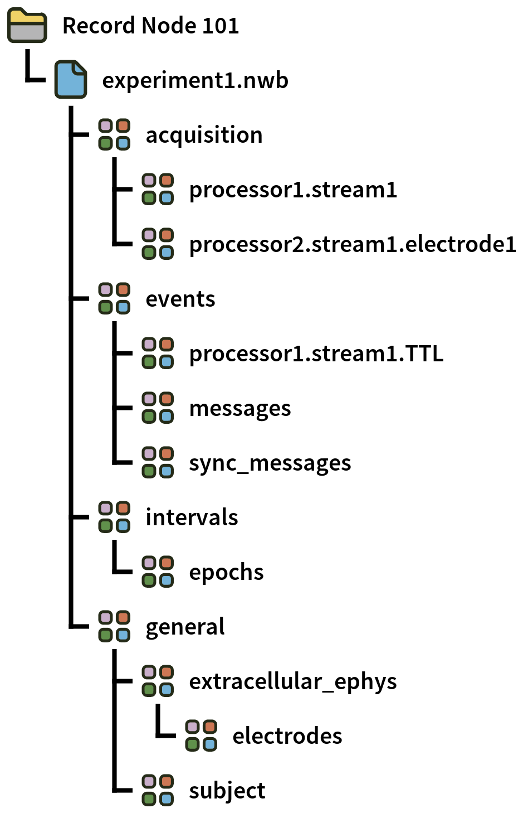
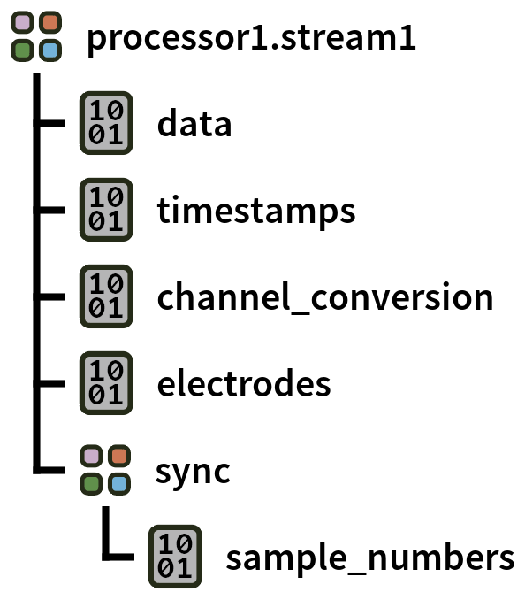
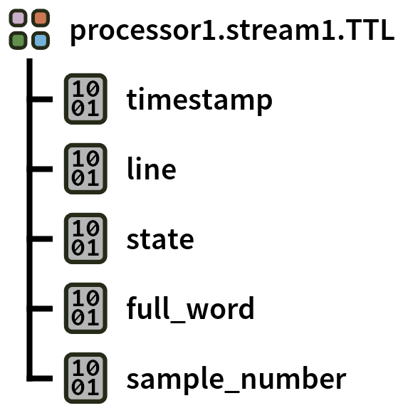
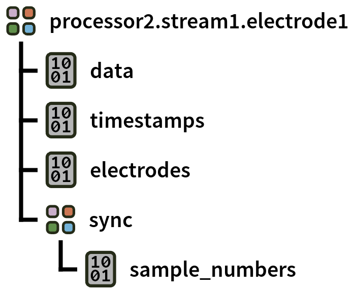

.. _nwbdataformat:
.. role:: raw-html-m2r(raw)
   :format: html

NWB Format
=====================

.. csv-table:: This is a data format based on the `NWB 2.X specification <https://nwb-schema.readthedocs.io/en/latest/format.html>`__. It replaces the deprecated NWB 1.0 format. Since it is not available by default, it must be downloaded via the GUI's Plugin Installer.
   :widths: 18, 80

   "*Platforms*", "Windows, Linux, macOS"
   "*Built in?*", "No"
   "*Key Developers*", "Aarón Cuevas López, Pavel Kulik, Josh Siegle, Stephanie Prince, Oliver Rübel"
   "*Source Code*", "https://github.com/open-ephys-plugins/nwb-format"

This page describes the files written by version 2.0 and later of the NWB Format plugin, which uses `AqNWB <https://github.com/NeurodataWithoutBorders/aqnwb>`__ to write NWB 2.11 files. The differences to files written by earlier versions are listed under :ref:`nwbearlierversions`.

**Advantages**

* NWB is a widely used format for sharing data among neuroscience labs, and the standard format of the `DANDI Archive <https://dandiarchive.org>`__.

* Data is stored in a single HDF5 file with self-documenting internal structure.

* Files can be read using the `PyNWB <https://pynwb.readthedocs.io/en/stable/index.html>`__ or `MatNWB <https://github.com/NeurodataWithoutBorders/matnwb>`__ libraries, or with the growing number of high-level tools that support the NWB format.

* Files are written in HDF5 SWMR (single-writer, multiple-reader) mode and flushed regularly, so data up to the last flush remains readable if the GUI crashes during a recording.

**Limitations**

* Data written since the last flush (at most about 10 s) is lost if the GUI crashes during a recording.

* The HDF5 C++ library is not thread-safe, so you cannot write to the NWB format from multiple Record Nodes simultaneously.

* Sorted spike units (e.g., from the Spike Sorter) are not stored yet.

File organization
####################

Within a Record Node directory, data for each **experiment** (stop/start acquisition) is contained in a separate NWB file, :code:`experiment<N>.nwb`. Individual **recordings** (start/stop recording) within an experiment are appended to the same datasets; the start and stop time of each recording are stored in the :code:`epochs` table.

If the recording directory is changed between recordings, the next recording starts a new file in the new directory. Existing files are never changed: if the new directory already contains :code:`experiment<N>.nwb` (e.g., after changing the directory and back), the new file is named after the experiment and its first recording, e.g. :code:`experiment1_recording3.nwb`.

The objects are named after the processor, its id, the data stream and (for spikes) the electrode, e.g., :code:`File Reader-100.example_data` (shown as :code:`processor1.stream1` in the figures). :code:`/general` also contains the devices, the subject (if provided, see below) and the versions of the GUI and the plugin (:code:`was_generated_by`).

Each NWB file also contains the following information:

* :code:`/nwb_version`: :code:`2.11.0` (text attribute)
* :code:`/identifier`: unique identifier for this file (text)
* :code:`/session_start_time` and :code:`/timestamps_reference_time`: date and time of timestamp 0 of the GUI in ISO 8601 format (see :ref:`nwbtimestamps`)
* :code:`/file_create_date`: date and time in ISO 8601 format (text array)
* :code:`/session_description`: description of the session (text)

Format details
################

Continuous
----------------

Continuous data is grouped by stream (a block of synchronously sampled channels):

Each **continuous** group in :code:`/acquisition` is an NWB *ElectricalSeries* containing the following datasets:

* :code:`data`: *M* samples x *N* channels of 16-bit integers. The :code:`channel_conversion` dataset stores the "bitVolts" value of each channel, converted to volts, i.e., :code:`data * channel_conversion` is the signal in volts. The :code:`channel_conversion` of auxiliary and ADC channels converts the values to volts as well.

* :code:`timestamps`: *M* 64-bit floats representing the timestamps (in seconds) of each sample.

* :code:`sync/sample_numbers`: *M* 64-bit integers representing the sample number of each sample since the start of acquisition, counted on the clock of the data stream.

* :code:`electrodes`: the rows of the electrodes table (see :ref:`nwbelectrodes`) that correspond to the *N* channels.

.. note:: :code:`sync/sample_numbers` is not yet part of the NWB specification. The :code:`sync` group of a *TimeSeries* has no specified contents; a standard location for sample numbers is being discussed in `nwb-schema#712 <https://github.com/NeurodataWithoutBorders/nwb-schema/issues/712>`__.

Events
-------

TTL events are stored in :code:`/events`, with one NWB *EventsTable* per event channel, named after the processor, its id and the data stream, e.g., :code:`Phase Detector-104.example_data.TTL` (:code:`TTL_1`, :code:`TTL_2`, ... for further event channels of the same processor and stream, as for the event folders of the :ref:`binaryformat`). Each event channel can contain data for multiple TTL lines.

Each row of the table is one event, with the following columns:

* :code:`timestamp`: timestamp (in seconds) of the event, 64-bit float

* :code:`line`: TTL line (0-based) that changed state, 8-bit unsigned integer

* :code:`state`: new state of the TTL line (1 = on, 0 = off), 8-bit unsigned integer

* :code:`full_word`: state of the first 64 TTL lines when the event occurred, 64-bit unsigned integer

* :code:`sample_number`: sample number of the event since the start of acquisition, 64-bit integer

.. note:: All event tables are created when the file is created, since objects can't be added to an HDF5 file in SWMR mode. An event channel without any events therefore results in an empty table. The `NWB Inspector <https://nwbinspector.readthedocs.io>`__ reports empty tables with :code:`check_empty_table`; use :code:`nwbinspector --ignore check_empty_table` to skip this check.

Spikes
--------

Spike data is organized by stream and electrode:

Each **spikes** group in :code:`/acquisition` is an NWB *SpikeEventSeries* containing the following datasets:

* :code:`data`: array with dimensions *S* spikes x *N* channels x *M* samples of 16-bit integers containing the spike waveforms. The :code:`conversion` attribute of :code:`data` stores the "bitVolts" value, converted to volts, i.e., :code:`data * data.conversion` is the waveform in volts.

* :code:`timestamps`: *S* 64-bit floats containing the timestamps (in seconds) of the peak of each spike.

* :code:`sync/sample_numbers`: *S* 64-bit integers containing the sample number of the peak of each spike since the start of acquisition.

* :code:`electrodes`: the rows of the electrodes table (see :ref:`nwbelectrodes`) that correspond to the *N* channels.

Messages
---------

Text messages (e.g., from the Message Center) are stored in the *EventsTable* :code:`/events/messages`, with the columns :code:`timestamp` (in seconds), :code:`annotation` (the text) and :code:`sample_number` (counted on the clock of the main sync stream of the Record Node).

Sync messages
--------------

The *EventsTable* :code:`/events/sync_messages` stores the start of each recording for each data stream, with the columns :code:`timestamp` (the first timestamp of the stream in the recording, in seconds), :code:`annotation` (the text of the sync message, e.g., :code:`Start Time for File Reader (100) - example_data @ 40000 Hz`), :code:`stream_id` (the id of the data stream) and :code:`sample_number` (the first sample number of the stream in the recording). For the :code:`Software Time` message, :code:`stream_id` is 0 and :code:`sample_number` is the system time in milliseconds since midnight Jan 1st 1970 UTC.

Epochs
-------

The *TimeIntervals* table :code:`/intervals/epochs` contains one row per recording, with the columns :code:`start_time` and :code:`stop_time` (in seconds) and :code:`tags` (e.g., :code:`recording1`).

.. _nwbelectrodes:

Electrodes
-----------

The electrodes table :code:`/general/extracellular_ephys/electrodes` contains one row per channel, with the columns :code:`location`, :code:`group_name`, :code:`group` (a reference to the *ElectrodeGroup* of the data stream) and :code:`channel_type` (0 = headstage, 1 = auxiliary, 2 = ADC).

.. _nwbtimestamps:

Timestamps
###########

Timestamps are the GUI's synchronized timestamps, as in the :ref:`binaryformat`: seconds since timestamp 0 of the GUI (sample 0 of the main sync stream, normally the start of acquisition). :code:`timestamps_reference_time` and :code:`session_start_time` are set to the date and time of timestamp 0. They are computed from the system time when the first recording of the file starts (the :code:`Software Time` sync message) minus the first recorded timestamp, so they are accurate to about one processing block.

Session and subject metadata
#############################

NWB files should describe the session and the subject; for example, the `DANDI Archive <https://dandiarchive.org>`__ requires a subject with :code:`subject_id`, :code:`species`, :code:`sex` and :code:`age` or :code:`date_of_birth`. There are two ways to add this metadata:

1. **A metadata file (before recording).** If a file named :code:`nwb_metadata.json` exists in the Record Node directory, the recording directory, or the directory selected for recordings in the GUI (searched in this order), the plugin writes its contents to each new NWB file. The file uses the same structure as `NeuroConv <https://neuroconv.readthedocs.io>`__ metadata:

   .. code-block:: json

      {
        "NWBFile": {
          "session_description": "Recording in V1 during visual stimulation",
          "experimenter": ["Last, First"],
          "institution": "...",
          "lab": "...",
          "keywords": ["V1", "Neuropixels"]
        },
        "Subject": {
          "subject_id": "mouse01",
          "species": "Mus musculus",
          "sex": "M",
          "age": "P90D"
        }
      }

   The supported fields are listed in the `plugin's README <https://github.com/open-ephys-plugins/nwb-format#session-and-subject-metadata>`__. The GUI log reports which metadata file was used, and any unsupported fields. The file is read when an NWB file is created (at the first recording of each experiment), so changes apply to the next experiment.

2. **After recording.** NWB files can be edited once they are closed (when the next experiment starts or the GUI quits), e.g., with `PyNWB <https://pynwb.readthedocs.io>`__ or `NWB GUIDE <https://nwb-guide.readthedocs.io>`__:

   .. code-block:: python

      from pynwb import NWBHDF5IO
      from pynwb.file import Subject

      with NWBHDF5IO("experiment1.nwb", "a") as io:
          nwbfile = io.read()
          nwbfile.subject = Subject(subject_id="mouse01", species="Mus musculus", sex="M", age="P90D")
          io.write(nwbfile)

The plugin also writes :code:`/general/was_generated_by` (the versions of the GUI and of the plugin) and :code:`/general/data_collection` (the GUI version).

Reading data in Python
#######################

* Create a :code:`Session` object using the `open-ephys-python-tools <https://github.com/open-ephys/open-ephys-python-tools>`__ package. The data format will be automatically detected.

* Alternatively, you can use the `PyNWB <https://pynwb.readthedocs.io/en/stable/>`__ package (version 4.2 or later, which supports NWB 2.11), e.g.:

  .. code-block:: python

     from pynwb import NWBHDF5IO

     with NWBHDF5IO("experiment1.nwb", "r") as io:
         nwbfile = io.read()
         series = nwbfile.acquisition["File Reader-100.example_data"]
         volts = series.data[:1000, :] * series.channel_conversion[:]
         ttl_events = nwbfile.events["Phase Detector-104.example_data.TTL"].to_dataframe()

Reading data in Matlab
#######################

* Use the `MatNWB <https://github.com/NeurodataWithoutBorders/matnwb>`__ library.

* The `open-ephys-matlab-tools <https://github.com/open-ephys/open-ephys-matlab-tools>`__ library currently reads only files written by earlier versions of the plugin (see :ref:`nwbearlierversions`).

Playing back NWB files
#######################

The :code:`NWB File` file source of the File Reader can play back NWB files written by this plugin, by earlier versions of this plugin, and by other tools (e.g., PyNWB).

.. _nwbearlierversions:

Files written by earlier versions
##################################

Files written by versions of the NWB Format plugin before 2.0 (NWB 2.4 or 2.5) differ as follows:

* Sample numbers are stored in a :code:`sync` dataset of each series instead of :code:`sync/sample_numbers`.

* TTL events are stored as a *TimeSeries* in :code:`/acquisition` (e.g., :code:`/acquisition/Phase Detector-104.example_data.TTL`), with the datasets :code:`data` (event codes indicating ON (+CH_number) and OFF (-CH_number) states), :code:`timestamps`, :code:`full_word` and :code:`sync`.

* Text messages and sync messages are stored as *AnnotationSeries* in :code:`/acquisition` (:code:`messages` and :code:`sync_messages`), which NWB 2.11 deprecated.

* The scaling factor of continuous data and spikes is stored both in :code:`data.conversion` and in :code:`channel_conversion`, so NWB readers that apply both scale the data twice. Use only :code:`channel_conversion`.

* :code:`session_start_time` is the time when the file was created, so all times are offset by the time between the start of acquisition and the start of recording.

* There is no :code:`channel_type` column in the electrodes table, and no :code:`epochs` table.

The open-ephys-python-tools package and the :code:`NWB File` file source read both layouts.

|
